# Find Anything: Stage 1 Design Report

EECS3311, Fall 2026. Amar Al-Zubaidi.

**Contents**

1. [Project overview](#1-project-overview)
2. [Feature specifications](#2-feature-specifications)
3. [UML class diagram](#3-uml-class-diagram)
4. [Design patterns](#4-design-patterns)
5. [Use-case diagram](#5-use-case-diagram)
6. [Use-case descriptions](#6-use-case-descriptions)
7. [Sequence diagrams](#7-sequence-diagrams)
8. [Feature-to-design traceability](#8-feature-to-design-traceability)
9. [Feature implementation explanations](#9-feature-implementation-explanations)
10. [Concurrency and the index lifecycle](#10-concurrency-and-the-index-lifecycle)

All diagrams were made in UMLet. Their editable sources (`.uxf`) and full-size images are in [`diagrams/`](diagrams/). On GitHub, click any diagram to open it at full resolution.

## 1. Project overview

### 1.1 Problem and motivation

People accumulate hundreds of files over the years: school assignments, work documents, slides, forms, and notes. They often remember what a file was about, but not its name or location, and the search built into most operating systems only matches filenames or exact keywords. Finding "the co-op information session slides from last year" often means browsing folders by hand. Finding a file is also usually not the real goal: users want an answer from the file, such as a date, a figure, or a slide number. Microsoft has recently added semantic file search to Windows, but only on new Copilot+ PCs with dedicated AI hardware, and it finds files rather than answering questions across them.

*Find Anything* is a cross-platform desktop application that indexes the files on a user's computer and lets them find files and get answers from them using natural language. It has a JavaFX GUI and a command-line interface (`findany`) with the same major functionality.

### 1.2 Target users

The primary users are everyday computer users with large, disorganized collections of personal and work files, such as students, office workers, and researchers. Secondary users are developers and power users who prefer to search from the terminal, served by the command-line interface.

### 1.3 Agent description

The agent interprets a natural-language request and decides how to fulfill it. It can:

- turn a vague description into one or more structured searches, combining keywords, meaning-based search, and filters like file type and date;
- read the relevant excerpts of the best-matching files;
- compare two files;
- answer questions using information drawn from several files, citing the file and passage behind each claim;
- handle follow-up requests that refine the previous result.

An AI agent is appropriate because matching a human description to the right files requires interpreting intent: synonyms, approximate dates, and descriptions of contents rather than exact words. Answering a question across files also takes several steps whose order isn't known in advance. A fixed pipeline can't decide these steps for each request, but an agent that plans and calls tools can. Everything that must be exact (indexing, searching, reading files, and checking citations) is done by deterministic code.

### 1.4 AI/LLM models

The system uses two kinds of models:

1. **An embedding model**, run locally inside the application, for meaning-based search. Running it locally means file contents are never uploaded anywhere for indexing. A small sentence-embedding model run with ONNX is likely sufficient for finding files.
2. **A language model for the agent**, chosen by the user:
   - a cloud model, such as Anthropic's Claude, chosen for its reliability at multi-step tool use; or
   - a local model, a small open-weight model run through Ollama, so no file content ever leaves the computer. This gives better privacy at the cost of answer quality and speed.

The specific models will be chosen after benchmarking candidates on representative hardware during implementation. The design doesn't depend on that choice: the agent only sees the `LlmClient` interface and the indexer only sees `EmbeddingModel`.

### 1.5 How the AI interacts with the rest of the system

The language model can't access the file system. It interacts with the system only through a fixed set of tools, each implemented deterministically: searching the index, reading an excerpt from an indexed file, and comparing two files. When the user submits a request, `AgentController` sends the conversation and the tool descriptions to the model. The model replies either with tool calls, which the system validates and executes before returning the results to the model, or with a final answer, whose citations are checked against the index before it is shown.

Each conversation is bound to one model for its whole life. Only the excerpts that tools return are sent to a cloud model, never whole files. Before a request reaches a cloud model, content from folders marked "local model only" is withheld, sensitive patterns are redacted, and the request is recorded in a privacy log the user can view.

### 1.6 Overall architecture

The system is organized in ten packages (Figure 1 in Section 3):

| Package | Responsibility |
|---|---|
| `ui` | JavaFX views, the GUI controller, and the CLI |
| `core` | `FindAnythingService`, the single entry point (facade) used by both the GUI and the CLI |
| `config` | Search folders, exclusion rules, model settings, and saving settings |
| `indexing` | Watching files, extracting text, and keeping the index up to date |
| `storage` | The searchable index (one entry per chunk of each file) and the content store (chunks and embeddings by content hash) |
| `embedding` | The local embedding model |
| `search` | Hybrid keyword and semantic search, and deterministic document comparison |
| `agent` | The agent loop, its tools, conversations, answers, and citation checking |
| `llm` | Language model clients behind one interface, and the privacy decorators |
| `privacy` | Redaction, sensitive-data patterns, folder policies, and the privacy log |

Dependencies point one way, from `ui` through `core` down to the lower packages, with no cycles (Figure 1). Work runs on four kinds of threads (Section 10):

- **The UI thread** handles the user's actions and never waits on slow work.
- **A watcher thread** records file changes.
- **One indexing worker thread** is the only writer of the index.
- **A pool of background threads** runs searches and agent requests.

Only one process at a time can update the index. If the GUI is open and the CLI is run, the second process opens the index read-only.

Libraries are hidden behind the design's own classes and interfaces, so each one can be replaced without changing the rest of the system:

| Library or service | Used for | Hidden behind |
|---|---|---|
| JavaFX | The GUI; `Platform.runLater()` hands results to the UI thread | `MainWindow`, `ResultsView`, `DetailPane`, `SettingsDialog`, `GuiController` |
| LangChain4j, with its Anthropic and Ollama chat models | Talking to the cloud or local language model | `LlmClient`, adapted by `LangChain4jClient` |
| LangChain4j's in-process embeddings, running an ONNX model | The local embedding model | `EmbeddingModel`, adapted by `LocalEmbeddingModel` |
| Apache Tika, with its forked parser | Detecting file types and extracting text in a separate process | `TextExtractor`, adapted by `IsolatedTextExtractor` |
| Apache Lucene | Keyword and vector search over the index, its write lock, commits, and refreshed snapshots | `SearchIndex` |
| Anthropic API (cloud) or Ollama (local) | Running the language model; these are external services, not libraries | The LLM Provider actor (Section 5) |

Lucene is the planned choice for the index, but the class diagrams don't name it: `SearchIndex` only describes the behaviour the design needs. The other libraries are named in the class diagrams' notes.

## 2. Feature specifications

The GUI has a search bar at the top, with a switch between Search mode and Ask mode, and the search folders shown as chips below it. A results table fills the left side, and a detail pane on the right shows a preview, the agent's conversation, or a comparison. Every feature is also available through the `findany` CLI.

### F01: Search folder management

**Description:** Lets the user choose which folders are searched, each one recursively, and exclude files within them using patterns.

**User interaction:** Search folders appear as chips below the search bar. An "+ Add folder" button opens a folder picker. Clicking a chip opens a menu with "Edit exclusions," "Pause," "Local model only" (F14), and "Remove." Global exclusions are managed in Settings > Indexing. Per-folder and global exclusions use the same pattern syntax (for example, `*.tmp` or `node_modules`), and both apply recursively to all subfolders.

**CLI:** `findany folders add|remove|pause|resume|list [path]` and `findany exclude add|remove|list <pattern> [--folder <path>]`.

**Input:** Folder paths and exclusion patterns.

**Output:** The updated search folders and exclusions, and an updated index.

**AI involvement:** Deterministic.

**Expected workflow:** The user adds a folder or a rule, and it is saved to settings. A new folder is watched for changes and queued for a rescan. A new rule triggers a rescan of the folders it applies to, which removes index entries for files the rule now excludes. The GUI shows indexing progress. Pausing a folder keeps its index entries but leaves it out of searches.

**Error/alternative cases:**

- A folder can't be read because of permissions: it isn't added, and the user is told why.
- An invalid pattern: it's rejected with a message.
- A folder is already inside another search folder: the user is told it's already covered.
- A search folder becomes unavailable (deleted, or a drive is disconnected): its chip is marked unavailable and its results are hidden.
- Another Find Anything process is updating the index (F03): folder and exclusion changes are refused with a message.
- Built-in exclusions for credential locations (SSH keys, browser profiles, `.env` files) always apply, and overriding them requires explicit confirmation.

### F02: Text extraction across formats

**Description:** During indexing, extracts plain text and metadata (title, author, modification date, page or slide count) from supported formats such as plain text, PDF, Word, and PowerPoint. The text is split into consecutive chunks that together cover the whole file, and each chunk keeps its page or slide number so citations can point to an exact location.

**User interaction:** No direct action is required. Files that couldn't be extracted show a warning icon in the results, and Settings lists the supported formats.

**CLI:** `findany index status --failed` lists files that couldn't be extracted.

**Input:** A file path.

**Output:** Text split into chunks, each with its page number, plus the file's metadata and an extraction status.

**AI involvement:** Deterministic.

**Expected workflow:** The indexer takes a file from the queue and computes a hash of its contents. If the same content was already extracted (for example, the file was renamed or copied), the stored chunks are reused. Otherwise, the file's type is detected from its contents, not only its extension, and its text is extracted page by page. Parsing runs isolated from the application with a time limit and a memory limit, so a malformed file can't crash or freeze it. Each page is split into chunks, and the file becomes keyword-searchable right away. Embeddings are added later (F05).

**Error/alternative cases:**

- Unsupported format: the file is indexed by name and metadata only.
- Corrupt or password-protected file, or parsing hits the time or memory limit: the file is marked as failed.
- Scanned PDF with no text layer: the file is marked with "no extractable text."
- Very large file: extraction stops at a size limit and the file is marked as partially indexed.

### F03: Incremental index updates

**Description:** Keeps the index in sync when files are created, modified, renamed, moved, or deleted, without rebuilding everything. It also catches up on changes made while the app was closed.

**User interaction:** Updates happen automatically while the GUI is open. A status indicator shows, for example, "Indexing n files" or "Up to date," and Settings has a manual "Rebuild index" button.

**CLI:** Every command first catches up on files changed since the last update. `findany watch` keeps the index updated until stopped, and `findany index status` and `findany index rebuild` are also available.

**Input:** File-system change events and, at startup, a comparison of the stored sizes and modification times against the disk.

**Output:** Updated index entries and status updates.

**AI involvement:** Deterministic. New content is embedded by the local embedding model, but the decision about what to update is deterministic.

**Expected workflow:** The file watcher records each change in a queue and returns immediately. Bursts of events for the same file are merged: a path is processed only once it has been unchanged for a short quiet period (about two seconds), since one save often produces several events. A deleted file is removed from the index at once. A rename or move arrives as a delete plus a create; because the new path has the same content hash, its stored chunks and embeddings are reused instead of extracting the file again. At startup, every search folder is rescanned by comparing sizes and modification times with the index.

**Error/alternative cases:**

- The operating system drops events during a flood of changes: the affected search folder is rescanned.
- A file is locked while it's being written: it's retried after another quiet period.
- Another process (the GUI or the CLI) is already updating the index: this one opens the index read-only, refreshes it every few seconds, and doesn't update it.

### F04: Filters

**Description:** Narrows results by file type, modification date, size, and location within the search folders.

**User interaction:** A Filters menu beside the search folder chips offers a type dropdown, a date range picker, a size range, and a location.

**CLI:** The options `--type pdf,docx`, `--after 2025-01-01`, `--before 2025-12-31`, `--min-size 1MB`, `--max-size 50MB`, and `--in <folder>`.

**Input:** Filter values.

**Output:** A filtered result list.

**AI involvement:** Deterministic. The agent can apply the same filters through its search tool (F07).

**Expected workflow:** The user changes a filter, the filters are validated, and the current search is re-run with the filters applied inside the index query. The results update.

**Error/alternative cases:**

- Invalid range, such as a start date after the end date: an inline validation message is shown.
- No results: a message suggests loosening the filters.
- A location outside the search folders: it's rejected.

### F05: Semantic search

**Description:** Finds passages by meaning rather than exact words, using the local embedding model. For example, "CV" finds a file that only says "résumé."

**User interaction:** This is part of the main search bar (F06). Results show the passage that matched.

**CLI:** Part of `findany search`. The `--keyword-only` option turns it off.

**Input:** Query text, the current scope, and filters.

**Output:** A ranked list of matching chunks with similarity scores.

**AI involvement:** Uses the local embedding model, with no LLM. With the same model and index, results are repeatable.

**Expected workflow:** While indexing, the indexing worker embeds chunks in the background whenever no file is waiting to be indexed. At search time, the query is converted to a vector locally, and the index returns the chunks in scope whose vectors are closest to it, with filters applied inside the query. These are passed to ranking (F06).

**Error/alternative cases:**

- The embedding model fails to load: the system falls back to keyword search only, with a warning.
- Files that haven't been embedded yet: they're still found by keyword search, and the status indicator shows that embedding is in progress.

### F06: Instant hybrid search (Search mode)

**Description:** The default search. It combines keyword and semantic results into one ranked list as the user types, without calling an LLM.

**User interaction:** The search bar is at the top of the window, set to Search mode. Results appear in a table (name, path, modification date, size) with the best-matching snippet. Before any query is typed, the table shows every file in the search folders, newest first.

**CLI:** `findany search <query> [filters] [--limit N]` prints ranked results with their paths and snippets.

**Input:** Query text, filters, and scope.

**Output:** Ranked files, each with its best-matching passage.

**AI involvement:** Hybrid: deterministic keyword search combined with the embedding model. No LLM is involved.

**Expected workflow:** The search runs on a background thread so typing stays responsive. Keyword and semantic matches are retrieved from the index and merged by rank (reciprocal rank fusion). The ranked chunks are then grouped by file, so each file appears once with its best passage. If the user has typed more since the search started, the outdated results are dropped.

**Error/alternative cases:**

- Special characters: they're treated literally, so the user never sees a query-syntax error.
- No results: the GUI suggests trying Ask mode (F07).

### F07: Natural-language search (Ask mode)

**Description:** The user describes a file vaguely, for example "the co-op info session slides from last year." The agent plans one or more structured searches with filters, inspects the results, refines the search if needed, and returns the best matches with a reason for each.

**User interaction:** The user switches the search bar to Ask mode and types a request. The detail pane shows the agent's steps as they happen (for example, "Searching slides from 2025…") and then its explanation, and the files it found appear in the results table.

**CLI:** `findany ask "<request>"` prints the results with explanations. The `--verbose` option also prints the agent's steps.

**Input:** The request, the current scope, the conversation so far (F12), and today's date, so the model can resolve phrases like "last year."

**Output:** Ranked files, each with an explanation of why it matches.

**AI involvement:** AI-based: the LLM agent plans, and deterministic tools execute.

**Expected workflow:** The agent controller sends the conversation and the tool descriptions to the conversation's model. The model replies with tool calls (such as a search with filters), which the system validates and executes. The results go back to the model, which may refine its search. Once the model returns its final selection, the files are displayed. The number of steps is limited.

**Error/alternative cases:**

- Invalid tool call, such as a malformed date or unknown file type: it's rejected, and the error is returned to the model so it can correct itself.
- Step limit reached: the best results so far are shown, with a notice.
- Model unavailable (no network, API error, or local runtime not running): the request is answered with instant search results (F06) and a message that the model is unavailable.
- Ambiguous request: the agent asks a clarifying question.

### F08: Question answering across files

**Description:** Answers a question using file contents, possibly combining information from several files, with a citation to the file and passage behind each claim.

**User interaction:** The user asks in Ask mode, for example "When does my lease end?" The answer appears in the detail pane with clickable citations that open the preview (F11) at the cited passage, and the cited files appear in the results table.

**CLI:** `findany ask "<question>"` prints the answer with numbered citations and a list of sources.

**Input:** The question, scope, and conversation so far.

**Output:** The answer text, its citations, and a list of sources.

**AI involvement:** AI-based, with deterministic tools.

**Expected workflow:** The agent searches, reads the relevant excerpts, and searches further if needed. It then writes an answer with citations in a structured format, which is parsed, and every citation is checked (F09) before the answer is displayed.

**Error/alternative cases:**

- No relevant information found: the agent says so rather than guessing.
- Files conflict with each other: both versions are presented with their sources.
- Model error: the same fallback as F07, with a retry option.

### F09: Citation verification

**Description:** A deterministic check that every quoted passage in an answer actually appears in the cited file at the stated page.

**User interaction:** Each citation shows a verified or unverified marker, and unverified claims are highlighted.

**CLI:** Citations are marked `[✓]` (verified) or `[?]` (unverified).

**Input:** The answer's citations and the indexed text.

**Output:** A verification status for each citation: verified, unverified, or source changed.

**AI involvement:** Deterministic. It checks the AI's output.

**Expected workflow:** The citations are parsed from the model's structured output. For each one, the cited file's chunks are looked up in the index and searched for the quoted text on the stated page, ignoring differences in whitespace. Each citation is then marked.

**Error/alternative cases:**

- Citations can't be parsed: the model is asked once to reformat; if it fails again, the answer is shown with an "unverified" warning.
- The cited file has changed since it was indexed: the citation is marked "source changed."
- The quote is close but not exact: it's marked unverified rather than passed leniently.

### F10: Document comparison

**Description:** Compares two files, such as two drafts of a lease or an assignment. It combines a deterministic text diff with an AI summary of the meaningful differences.

**User interaction:** The user selects two results and chooses "Compare" from the right-click menu, or asks in Ask mode ("What changed between my two lease drafts?"). The detail pane shows a side-by-side view highlighting the differences, alongside the summary.

**CLI:** `findany compare <fileA> <fileB> [--diff-only]`.

**Input:** Two files, either selected by the user or found by the agent.

**Output:** A highlighted diff, plus a summary of the key differences with citations.

**AI involvement:** Hybrid.

**Expected workflow:** The full text of both files is rebuilt from their chunks in order and diffed line by line. Only the diff, not the full files, is sent to the model, which summarizes it. The summary's citations are verified (F09), and both are displayed.

**Error/alternative cases:**

- One of the files has no extracted text: a message explains why it can't be compared.
- The files are identical in text: the system reports no differences without calling the model.
- The files are unrelated: the summary says so.
- The diff is very large: it's summarized section by section.
- Model unavailable: the diff is shown without a summary, with a message.

### F11: Result preview with highlighting

**Description:** Shows a result's extracted text with the matching or cited passages highlighted, scrolled to the relevant location.

**User interaction:** Selecting a result shows its preview in the detail pane. In Ask mode, clicking a citation switches the pane from the conversation to the preview, with a Back button to return. The preview has "Open file" and "Show in folder" buttons.

**CLI:** `findany show <file> [--highlight "<query>"]` prints the extracted text with matches marked.

**Input:** The selected file, plus a query or a cited quote.

**Output:** A preview with highlights.

**AI involvement:** Deterministic.

**Expected workflow:** The file's chunks are loaded in order and its text is rebuilt. The matches or the cited passage are highlighted, and the view scrolls to the first highlight.

**Error/alternative cases:**

- The file was deleted since indexing: a message is shown, and the file is queued for removal from the index.
- No extracted text: only the metadata is shown.

### F12: Conversation follow-ups

**Description:** The agent remembers the current conversation's requests and results, so follow-ups like "only the ones from 2025" or "what does the second one say about deadlines?" build on them.

**User interaction:** In Ask mode, the conversation appears in the detail pane. Past conversations are in a drawer, with a "New conversation" button.

**CLI:** `findany ask` with no arguments starts an interactive session. `findany ask --continue "<request>"` continues the last conversation.

**Input:** The follow-up and the conversation history.

**Output:** Refined results or a new answer.

**AI involvement:** AI-based, with deterministic memory management: storing the history, saving conversations, and trimming the history to fit the model's context.

**Expected workflow:** Each request, tool result, and answer is added to the conversation, which is saved after every answer. The whole conversation, trimmed to fit, is sent with each new request, so the model can refer to earlier results. Each conversation keeps the model it was started with, even if the user later changes the backend (F13).

**Error/alternative cases:**

- Ambiguous reference, such as "the second one" when no list was shown: the agent asks for clarification.
- History too long: the oldest exchanges are dropped.
- Unrelated new topic: it's treated as a fresh search.
- A saved conversation whose model is no longer configured: it opens read-only, and the user can start a new one.

### F13: Model backend selection and privacy log

**Description:** Lets the user choose between a cloud model and a local model, and view a log of everything sent to cloud models. All backends implement a common interface, so new providers can be added later without changing the agent.

**User interaction:** In Settings > Model, the user chooses a backend, enters an API key or a local model name, and can click "Test connection." A privacy log viewer lists each cloud request with its timestamp, the excerpts sent, and any redactions.

**CLI:** `findany model set cloud|local [--model <name>]`, `findany model test`, and `findany privacy-log [--last N]`.

**Input:** Backend settings and an API key.

**Output:** The backend used for new conversations, and the log entries.

**AI involvement:** Deterministic. It configures the AI components but doesn't involve them.

**Expected workflow:** The user chooses a backend, and a client for it is created and sent a minimal test request. If the test succeeds, the settings are saved and used for every new conversation. Existing conversations keep their own model (F12). Every request to a cloud model is appended to the privacy log after redaction, so the log shows exactly what was sent.

**Error/alternative cases:**

- Invalid API key: the connection test fails with a clear message.
- Local runtime not running: setup instructions are shown.
- Backend switched during a conversation: the current conversation keeps its model, and the next new conversation uses the new backend.

### F14: Sensitive-data protection

**Description:** Protects sensitive data in three ways:

- built-in exclusion of credential locations from indexing;
- per-folder "local model only" policies;
- detection and redaction of sensitive patterns (card numbers, SINs, private keys, and API keys) before anything is sent to a cloud model.

**User interaction:** Settings > Privacy has toggles for each redaction category. A search folder chip's menu offers a "Local model only" option. Redactions appear in the privacy log (F13).

**CLI:** `findany policy local-only <folder>` and `findany privacy redact --enable|--disable <category>`.

**Input:** Outgoing messages, with the source files each one came from, and the folder policies.

**Output:** Redacted messages, with withheld sources reported to the user.

**AI involvement:** Deterministic.

**Expected workflow:** Before every cloud request, any message whose content came from a local-only folder is replaced with a "withheld" marker. The remaining text is scanned for sensitive patterns, and matches are replaced with placeholders. The request is then logged and sent. Requests to a local model skip these steps, because nothing leaves the computer. Because a conversation never changes model, text a local model has seen can't reach a cloud model through the conversation history.

**Error/alternative cases:**

- Needed sources come from a local-only folder: the answer notes that some sources were withheld and suggests a conversation with the local model.
- False positive: harmless, since the text is only redacted.
- Unstructured sensitive information, such as a medical note: detection can't catch it. Settings states this limitation plainly.

## 3. UML class diagram

The class model has 58 classes and interfaces in ten packages. To keep each figure readable, it is shown as an overview of the packages (Figure 1) followed by one diagram per area (Figures 2 to 8). Together they form one model: each class is drawn with its attributes and methods in the diagram of its own package. A grey box named `package.Class` is a class from another package, drawn without its members, to show how the area connects to the rest of the system. The complete model in a single diagram is [`cd-full`](diagrams/class-diagrams/cd-full.png); it is large, so it is best viewed zoomed in.

The diagrams are at the specification level. They show each class's responsibilities through its public methods and important attributes. Constructors, most getters and setters, and small data records (such as `Preview`, `Comparison`, and `DiffHunk`) are left out; records appear only as types. Members are shown when other diagrams or this report rely on them:

- **Private methods** that appear as steps in the sequence diagrams: `Indexer.indexFile()`, `rescanFolder()`, `embedNextBatch()`, and `notifyStatus()` (SD01), and `SearchEngine.fuseRankings()` (SD02).
- **Getters** that another class calls in a sequence diagram or that carry meaning, such as `Conversation.getModelSettings()` (SD03), `ToolRegistry.getToolSpecs()` (SD03), and `SearchIndex.getChunks()` (SD03, SD05, SD06).
- **Setters** that are user-level operations, such as `SearchFolder.setPaused()` and `Redactor.setCategoryEnabled()`. Design decisions that a box can't show, especially which thread may call what, are written as notes attached to the class they concern.

**Notation**, following the course slides:

- «interface» marks interfaces, and abstract classes are in italics.
- `+`, `-`, and `#` mark public, private, and protected members. Static members are underlined. A method without a return type returns `void`.
- A filled diamond is composition, a hollow diamond is aggregation, and a plain arrow is an association. A dashed arrow is a dependency, a dashed arrow with a hollow triangle is an interface realization, and a solid arrow with a hollow triangle is inheritance.
- Numbers at the ends of a line are multiplicities.
- Stereotypes such as «Facade», «Command», and «Adapter» mark each class's role in a design pattern (Section 4).

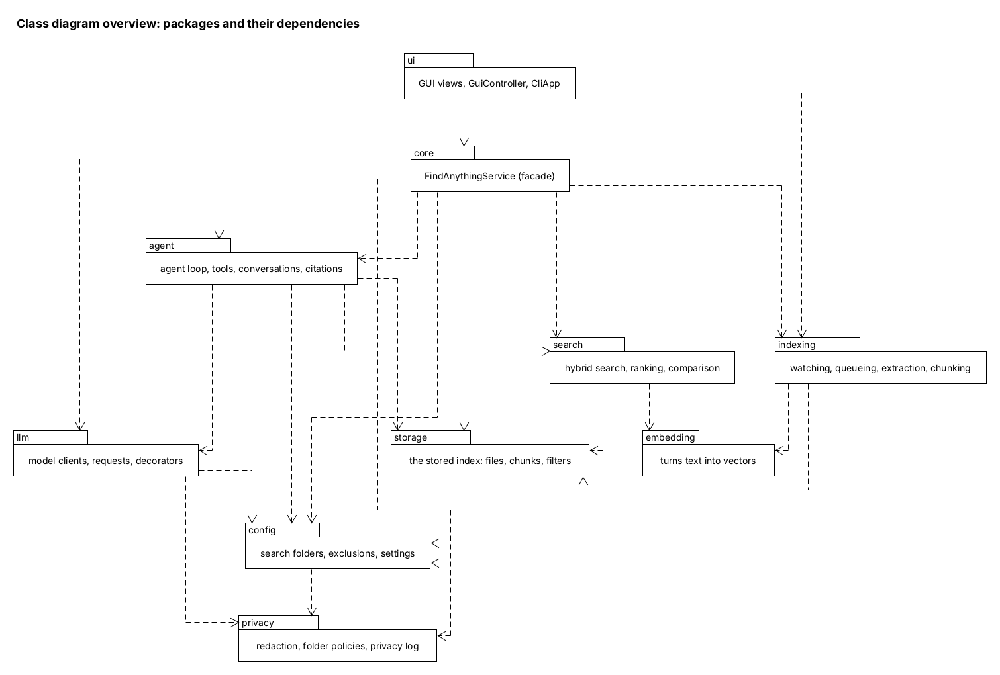

*Figure 1. Package overview: the ten packages and the dependencies between them.*

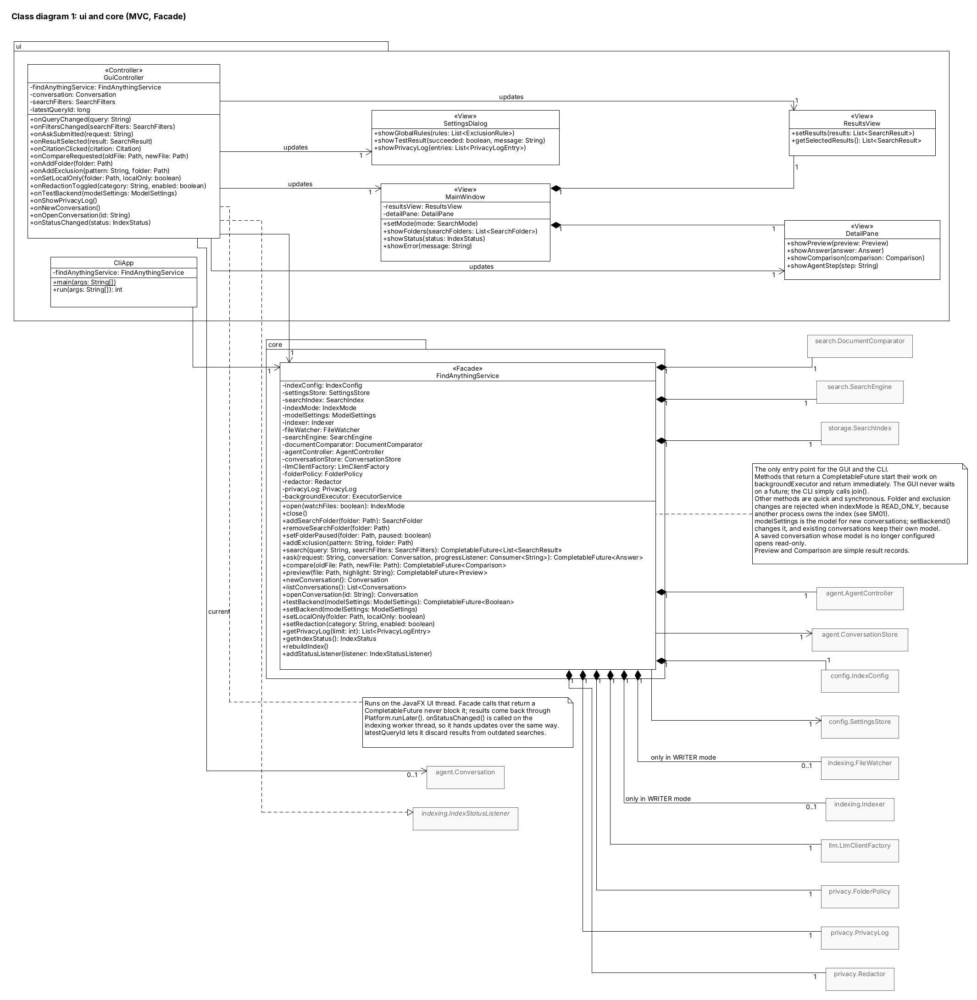

*Figure 2. `ui` and `core`: the GUI views, `GuiController`, and `CliApp` all go through the `FindAnythingService` facade.*

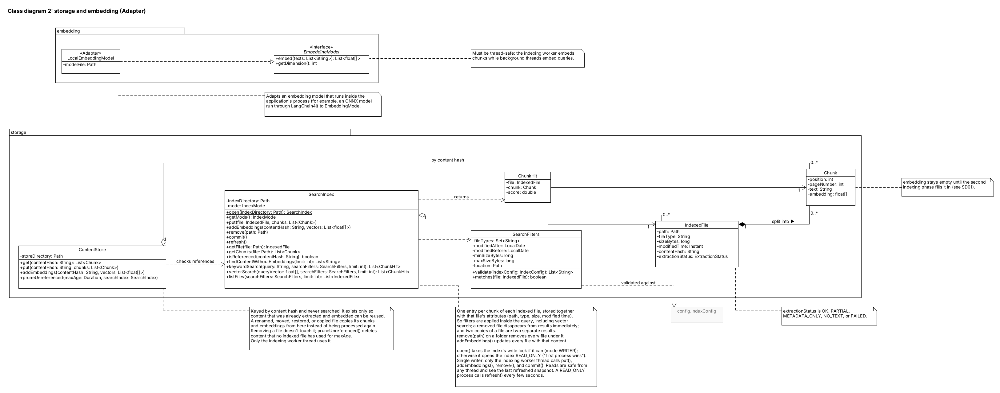

*Figure 3. `storage` and `embedding`: the searchable index, with one entry per chunk of each file; the content store, which lets renamed, moved, and copied files reuse their chunks and embeddings; and the embedding model.*

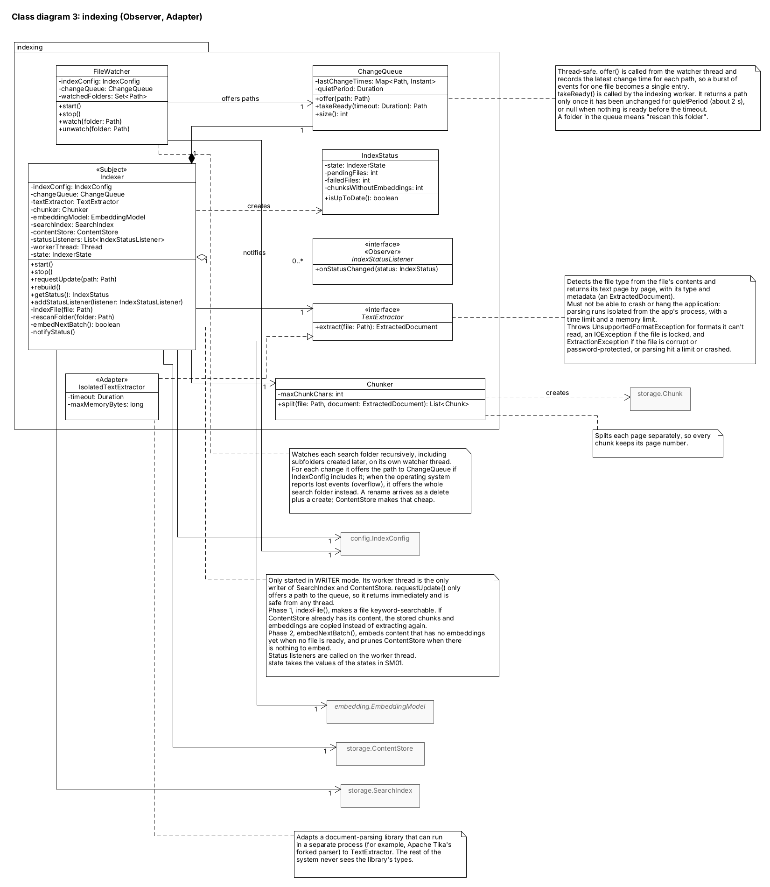

*Figure 4. `indexing`: the file watcher, the change queue, the single-writer `Indexer`, and text extraction.*

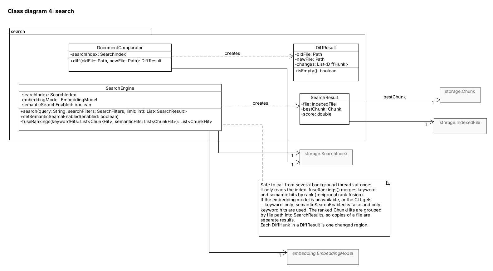

*Figure 5. `search`: hybrid search and deterministic document comparison.*

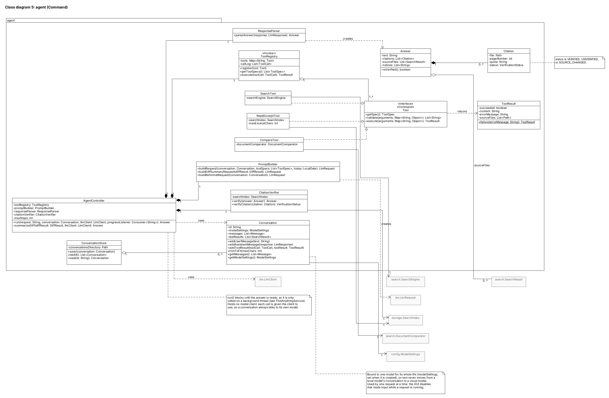

*Figure 6. `agent`: the agent loop, tools as commands, conversations, answers, and citation verification.*

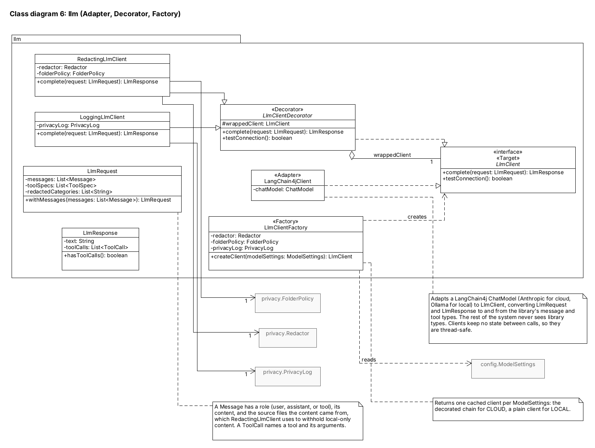

*Figure 7. `llm`: the model client interface, its adapter, the privacy decorators, the factory, and the request and response model.*

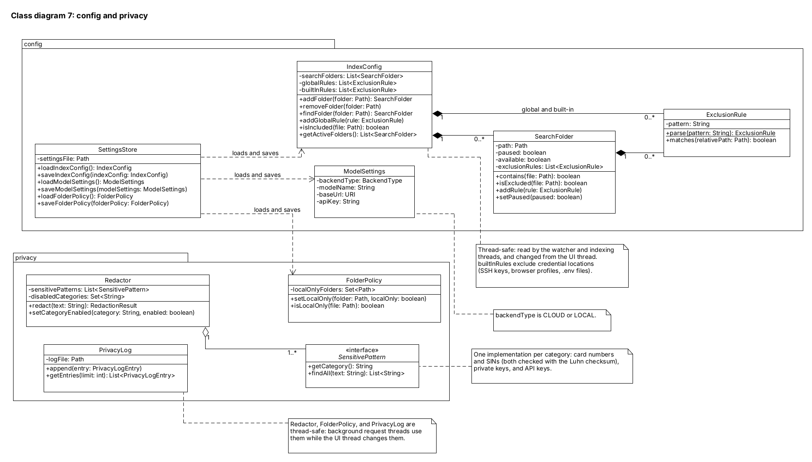

*Figure 8. `config` and `privacy`: search folders, exclusion rules, settings, redaction patterns, folder policies, and the privacy log.*

## 4. Design patterns

The design uses five patterns from the course to solve specific problems: Facade, Observer, Command, Adapter, and Decorator. Two smaller uses, a factory and MVC, are described after them. Each pattern is marked with stereotypes in the class diagrams.

### 4.1 Facade

**Design problem:** The system needs both a GUI and a CLI that offer the same major functionality. Each operation involves several subsystems. Adding a search folder, for example, updates the configuration, saves the settings, starts watching the folder, and queues it for indexing. Slow operations must also run off the UI thread, and changes to the index must be refused when another process owns it. Without a single entry point, both front ends would have to coordinate all of this themselves.

**Participating classes and roles:**

- **`FindAnythingService`** is the facade. It offers one method per user-level operation, such as `search()`, `ask()`, `compare()`, `preview()`, and `addSearchFolder()`. It coordinates the subsystems behind it, runs slow work on its background executor, and returns a `CompletableFuture`.
- **The subsystem classes** do the actual work and know nothing about the facade:
  - `IndexConfig`, `SettingsStore`, `SearchIndex`, `Indexer`, and `FileWatcher`;
  - `SearchEngine`, `DocumentComparator`, `AgentController`, and `ConversationStore`;
  - `LlmClientFactory`, `FolderPolicy`, `Redactor`, and `PrivacyLog`.
- **`GuiController` and `CliApp`** are the clients. Each is a thin layer that turns user input into facade calls and displays the results. The GUI handles a future's result when it arrives, and the CLI simply waits for it with `join()`.

**Why it is appropriate:** The GUI and CLI requirement means two clients need exactly the same operations. A facade gives both one simplified interface and keeps the order of cross-subsystem steps, the threading rules, and the read-only check in one place.

**What would be harder without it:** The coordination logic would be duplicated in `GuiController` and `CliApp` and would gradually drift apart. Both front ends would depend on more than a dozen subsystem classes, so a change to any subsystem could break both, and every feature would have to be implemented twice.

### 4.2 Observer

**Design problem:** Indexing runs on its own worker thread, and its progress must be shown in the GUI. The indexer must not depend on the GUI, because the CLI runs the same indexer with no GUI at all.

**Participating classes and roles:**

- **`Indexer`** is the subject. It keeps a list of `IndexStatusListener`s. Its `notifyStatus()` method sends each of them the current `IndexStatus` after each piece of work the worker finishes (SD01).
- **`IndexStatusListener`** is the observer interface, with one method, `onStatusChanged(status)`.
- **`GuiController`** is a concrete observer. It hands each update to the JavaFX thread, which updates the status indicator in `MainWindow`.
- **`IndexStatus`** is the state passed to observers: the indexer's state, the number of pending and failed files, and the number of chunks still without embeddings.
- **`FindAnythingService.addStatusListener()`** lets a client register without knowing about `Indexer`.

**Why it is appropriate:** This is one-to-many, event-driven notification, where the source must not know who is listening. The CLI simply registers no listener, and new listeners, such as a system tray icon, can be added without changing the indexer.

**What would be harder without it:** `Indexer` would call `MainWindow` directly. The indexer could then not run in the CLI without pulling in GUI classes, and adding any new consumer of progress updates would mean editing the indexer.

### 4.3 Command

**Design problem:** The language model decides at runtime which operation to run, by naming a tool and passing JSON arguments. The agent must validate, execute, and record any of several operations in the same way. It should also be possible to add tools without changing the agent loop.

**Participating classes and roles:**

- **`Tool`** is the command interface, with `getSpec()`, `validate()`, and `execute()`.
- **`SearchTool`, `ReadExcerptTool`, and `CompareTool`** are the concrete commands.
- **`SearchEngine`, `SearchIndex`, and `DocumentComparator`** are the receivers, which do the actual work.
- **`ToolRegistry`** is the invoker. It looks up a command by name, validates its arguments, executes it, and records every call in its call log. When validation fails, it returns `ToolResult.failure()` with the errors instead of executing.
- **`AgentController`** is the client. It passes each `ToolCall` in the model's response to the registry and adds the `ToolResult` to the conversation.

**Why it is appropriate:** A tool call from the model is already a request object that has to be dispatched. Encapsulating each operation as an object gives every tool the same validation, error handling, and logging. `getToolSpecs()` also gives the model a description of every tool from the same objects that execute them. The call log provides the traces needed for behavioural testing with KUMA in Stage 3.

**What would be harder without it:** `AgentController` would need a switch on the tool name, with validation repeated in every branch, and every new tool would change the agent loop. The tool descriptions sent to the model could drift from the code that runs them, and logging would be inconsistent across tools.

### 4.4 Adapter

**Design problem:** The system relies on outside libraries for three jobs that have their own interfaces and data types:

- talking to language models (LangChain4j's `ChatModel`, for Anthropic and Ollama);
- parsing documents (Apache Tika);
- running the embedding model.

If those types spread through the code, the design would be tied to particular libraries, and replacing one would mean changes throughout the system.

**Participating classes and roles:**

- **`LlmClient`, `TextExtractor`, and `EmbeddingModel`** are the target interfaces, written in the system's own terms (`LlmRequest`, `LlmResponse`, `ExtractedDocument`, and `float[]` vectors).
- **`LangChain4jClient`, `IsolatedTextExtractor`, and `LocalEmbeddingModel`** are the adapters. For example, `LangChain4jClient` converts an `LlmRequest`'s messages and tool specs to the library's message and tool types, and converts the reply back to an `LlmResponse`.
- **LangChain4j's `ChatModel`, Tika's forked parser, and the ONNX embedding model** are the adaptees, which can't be changed.
- **`AgentController`, `Indexer`, and `SearchEngine`** are the clients. They only know the target interfaces.

**Why it is appropriate:** The library interfaces are fixed and don't match the system's own model, so translation belongs at the boundary. Swapping a library, or adding a provider the library supports, changes one adapter. Tests can use simple fakes of the three interfaces instead of real models and parsers, so they are fast and deterministic.

**What would be harder without it:** Library types would spread into `AgentController`, `PromptBuilder`, `Indexer`, and `SearchEngine`. Upgrading or replacing a library would require changes throughout the system, and the agent loop couldn't be tested without a real model.

### 4.5 Decorator

**Design problem:** Every request sent to a cloud model must have content from local-only folders withheld and sensitive patterns redacted, and its final content must be recorded in the privacy log. Requests to a local model need none of this. These concerns shouldn't be written into the adapter, and the agent shouldn't be able to skip them by accident.

**Participating classes and roles:**

- **`LlmClient`** is the component interface.
- **`LangChain4jClient`** is the concrete component.
- **`LlmClientDecorator`** is the abstract decorator. It implements `LlmClient` and holds the wrapped `LlmClient` that it delegates to.
- **`RedactingLlmClient` and `LoggingLlmClient`** are the concrete decorators. For a cloud backend, `LlmClientFactory` builds the chain `RedactingLlmClient` → `LoggingLlmClient` → `LangChain4jClient`, so the log records exactly what is sent, after redaction.

**Why it is appropriate:** Decorators add responsibilities by wrapping an object behind the same interface, so the agent can't tell the difference. The wrapping order expresses the privacy policy directly, and it is decided in one place, the factory. Testing a decorator only needs a fake inner client.

**What would be harder without it:** Redaction and logging would be mixed into `AgentController` or the adapter. A new adapter, or a new caller such as document comparison, could then silently skip redaction, which would be a privacy bug. Alternatively, the design would need a subclass for every combination, such as a `RedactingLoggingLangChain4jClient`.

### 4.6 Other patterns used

**Factory:** `LlmClientFactory.createClient(modelSettings)` builds the right client for a conversation's model: the decorated chain for a cloud backend, or a plain `LangChain4jClient` for a local one. It caches one client per `ModelSettings`. Callers never construct clients themselves, so the privacy decision of which decorators apply is made in one place.

**MVC:** `MainWindow`, `ResultsView`, `DetailPane`, and `SettingsDialog` are views that only display data. `GuiController` handles user events, calls the model, and updates the views. `FindAnythingService` and the domain objects behind it are the model, which the CLI shares. Views never call the model directly.

## 5. Use-case diagram

The primary actor is the User, through either the GUI or the CLI. Two secondary actors are involved:

- **The File System** triggers index updates when files change.
- **The LLM Provider** is an external system used by the agent features and by connection tests. It is either a cloud API or a local runtime such as Ollama.

The embedding model runs inside the application, so it isn't an actor.

Four smaller use cases are shared by the main ones:

- **Query the index** is included in Search files, Find a file with natural language, and Ask a question across files.
- **Verify citations** is included in question answering and comparison.
- **Redact outgoing text** is included in Find a file with natural language, Ask a question across files, and Compare documents, which send file content to the model. It only applies when the cloud backend is selected.
- **Apply filters** optionally extends Search files.

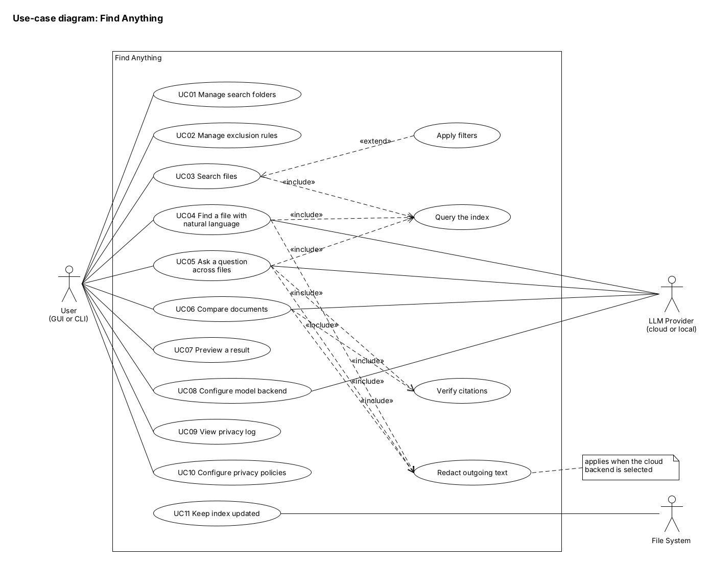

*Figure 9. Use-case diagram.*

## 6. Use-case descriptions

The steps below describe the GUI. The CLI follows the same steps through the equivalent `findany` command (Section 2).

### UC01: Manage search folders

- **Actors:** User.
- **Goal:** Choose which folders Find Anything searches.
- **Preconditions:** The application is running and owns the index (no other Find Anything process is updating it).
- **Trigger:** The user clicks "+ Add folder," or opens a search folder chip's menu.
- **Main success scenario:**
  1. The user clicks "+ Add folder" and picks a folder.
  2. The system checks that the folder can be read and isn't already covered by another search folder.
  3. The system adds the folder, saves the settings, starts watching it, and queues it for indexing.
  4. The new chip appears, and the status indicator shows indexing progress (UC11).
- **Alternative/exception flows:**
  - 2a. The folder can't be read: the system explains why, and nothing changes.
  - 2b. The folder is inside an existing search folder: the system says it's already covered.
  - 1a. The user pauses a folder from its chip: its index entries are kept, but searches skip it until it is resumed.
  - 1b. The user removes a folder: its entries are removed from the index.
  - Another process owns the index: the change is refused with a message.
- **Postconditions:** The search folders are saved, and the index is being updated to match them.
- **Related features:** F01.

### UC02: Manage exclusion rules

- **Actors:** User.
- **Goal:** Keep unwanted files out of the index and results.
- **Preconditions:** The application owns the index. For a per-folder rule, the folder is a search folder.
- **Trigger:** The user chooses "Edit exclusions" on a chip, or opens Settings > Indexing for a global rule.
- **Main success scenario:**
  1. The user enters a pattern such as `*.tmp` or `node_modules`.
  2. The system parses the pattern.
  3. The system adds the rule to the folder (or globally) and saves the settings.
  4. The affected folders are rescanned, and files that the rule now excludes are removed from the index.
- **Alternative/exception flows:**
  - 2a. The pattern is invalid: it's rejected with a message.
  - 1a. The user tries to override a built-in credential exclusion: the system asks for explicit confirmation first.
- **Postconditions:** The rule is saved, and excluded files no longer appear in results.
- **Related features:** F01, F14.

### UC03: Search files

- **Actors:** User.
- **Goal:** Find files quickly by keywords or meaning, without involving the language model.
- **Preconditions:** At least one search folder has been indexed, at least partly.
- **Trigger:** The user types in the search bar in Search mode, or changes a filter.
- **Main success scenario:**
  1. The user types a query.
  2. The system validates the current filters (Apply filters).
  3. On a background thread, the system queries the index with keyword search and, if the embedding model is available, semantic search (Query the index).
  4. The system merges the two rankings and groups the matches by file.
  5. The results table shows each file with its best-matching snippet.
- **Alternative/exception flows:**
  - 1a. The query is empty: the table lists every file in the search folders, newest first.
  - 2a. The filters are invalid: an inline message is shown, and no search is run.
  - 3a. The embedding model isn't available: only keyword search is used, and a warning is shown.
  - 4a. The user typed more before the search finished: the outdated results are dropped.
  - 5a. There are no results: the system suggests loosening the filters or trying Ask mode.
- **Postconditions:** The results table shows the ranked files. The index is unchanged.
- **Related features:** F04, F05, F06.

### UC04: Find a file with natural language

- **Actors:** User (primary), LLM Provider.
- **Goal:** Find a file from a vague description.
- **Preconditions:** A model backend is configured, and the files are indexed.
- **Trigger:** The user submits a request in Ask mode.
- **Main success scenario:**
  1. The user describes the file, for example "the co-op info session slides from last year."
  2. The system sends the conversation and the tool descriptions to the conversation's model (Redact outgoing text, if it is a cloud model).
  3. The model asks for one or more searches with filters. The system validates and runs each one (Query the index) and shows each step in the detail pane.
  4. The model refines its searches if needed, then returns its final selection with a reason for each file.
  5. The system shows the files in the results table and the explanation in the detail pane, and saves the conversation.
- **Alternative/exception flows:**
  - 3a. A tool call is invalid: the error is returned to the model, which corrects the call.
  - 3b. The model is unavailable: the system shows instant search results for the request (UC03), with a message.
  - 4a. The step limit is reached: the best results so far are shown, with a notice.
  - 4b. The request is ambiguous: the model asks a clarifying question, and the user answers in the same conversation.
- **Postconditions:** The conversation includes the request and its result, so follow-ups can build on it.
- **Related features:** F07, F12.

### UC05: Ask a question across files

- **Actors:** User (primary), LLM Provider.
- **Goal:** Get an answer from the contents of one or more files, with sources the user can check.
- **Preconditions:** A model backend is configured, and the files are indexed.
- **Trigger:** The user asks a question in Ask mode.
- **Main success scenario:**
  1. The user asks a question, for example "When does my lease end?"
  2. The model searches the index and reads excerpts from the most relevant files through tools (Query the index; Redact outgoing text, if it is a cloud model).
  3. The model writes an answer with a citation for each claim.
  4. The system verifies every citation against the indexed text (Verify citations).
  5. The detail pane shows the answer with a verified or unverified marker on each citation, and the cited files appear in the results table.
- **Alternative/exception flows:**
  - 2a. Nothing relevant is found: the answer says so instead of guessing.
  - 2b. Some needed sources are in local-only folders and the model is a cloud model: they're withheld, and the answer says so.
  - 3a. The answer can't be parsed: the model is asked once to reformat it. If it fails again, the answer is shown marked unverified.
  - 4a. A quote isn't found at the cited place: that citation is marked unverified and highlighted.
  - 4b. The cited file changed after it was indexed: the citation is marked "source changed."
  - The model is unavailable: the same fallback as UC04.
- **Postconditions:** The answer and its sources are part of the conversation. Clicking a citation opens UC07.
- **Related features:** F08, F09, F12, F14.

### UC06: Compare documents

- **Actors:** User (primary), LLM Provider.
- **Goal:** See what changed between two versions of a document, and what the changes mean.
- **Preconditions:** Both files are indexed with extracted text.
- **Trigger:** The user selects two results and chooses "Compare," or asks the agent to compare two files.
- **Main success scenario:**
  1. The user selects two results and chooses "Compare."
  2. The system rebuilds both texts from the index and computes a line diff.
  3. The system sends only the diff to the model and asks for a summary of the meaningful changes (Redact outgoing text, if it is a cloud model).
  4. The system verifies the summary's citations (Verify citations).
  5. The detail pane shows the highlighted side-by-side diff with the summary.
- **Alternative/exception flows:**
  - 2a. A file has no extracted text: a message explains why it can't be compared.
  - 2b. The texts are identical: the system reports no differences without calling the model.
  - 3a. The diff is very large: it's summarized section by section.
  - 3b. The model is unavailable: the diff is shown without a summary.
  - 1a. In Ask mode, the agent finds the two files and uses the same comparison through a tool (UC05).
- **Postconditions:** The comparison is shown. The files and index are unchanged.
- **Related features:** F10, F09.

### UC07: Preview a result

- **Actors:** User.
- **Goal:** Read the relevant part of a file without opening it in another application.
- **Preconditions:** The file is in the index.
- **Trigger:** The user selects a result, or clicks a citation.
- **Main success scenario:**
  1. The user selects a result.
  2. The system rebuilds the file's text from its chunks.
  3. The system highlights the matches for the current query, or the cited passage.
  4. The detail pane shows the text, scrolled to the first highlight, with "Open file" and "Show in folder" buttons.
- **Alternative/exception flows:**
  - 2a. The file was deleted since it was indexed: a message is shown, and the file is queued for removal from the index.
  - 2b. The file has no extracted text: only its metadata is shown.
- **Postconditions:** The preview is shown. In Ask mode, Back returns to the conversation.
- **Related features:** F11.

### UC08: Configure model backend

- **Actors:** User (primary), LLM Provider.
- **Goal:** Choose which model new conversations use.
- **Preconditions:** None. For a local backend, a local runtime such as Ollama is installed.
- **Trigger:** The user opens Settings > Model.
- **Main success scenario:**
  1. The user chooses cloud or local, and enters an API key or a model name.
  2. The user clicks "Test connection."
  3. The system creates a client for those settings and sends a minimal request to the provider.
  4. The test succeeds, and the system saves the settings.
  5. New conversations use the new backend.
- **Alternative/exception flows:**
  - 3a. The API key is invalid, or the local runtime isn't running: the test fails with a clear message (with setup instructions for a local runtime), and nothing is saved.
  - 5a. A conversation is in progress: it keeps its own model.
- **Postconditions:** The model settings are saved.
- **Related features:** F13.

### UC09: View privacy log

- **Actors:** User.
- **Goal:** See exactly what was sent to cloud models.
- **Preconditions:** None.
- **Trigger:** The user opens "Privacy log" in Settings.
- **Main success scenario:**
  1. The user opens the privacy log.
  2. The system loads the most recent entries.
  3. The log shows each cloud request with its timestamp, the excerpts sent, and the redactions made.
- **Alternative/exception flows:**
  - 2a. Nothing has been sent to a cloud model: the log is empty and says so.
- **Postconditions:** None. The log is read-only.
- **Related features:** F13, F14.

### UC10: Configure privacy policies

- **Actors:** User.
- **Goal:** Control which content may reach a cloud model.
- **Preconditions:** For a local-only policy, the folder is a search folder.
- **Trigger:** The user chooses "Local model only" on a chip, or changes a redaction toggle in Settings > Privacy.
- **Main success scenario:**
  1. The user marks a search folder as "Local model only."
  2. The system saves the folder policy.
  3. From then on, content from that folder is withheld from every cloud request.
- **Alternative/exception flows:**
  - 1a. The user turns a redaction category, such as API keys, on or off: the redactor uses the new setting for the next request.
- **Postconditions:** The policy is saved and applies to every later request.
- **Related features:** F14.

### UC11: Keep index updated

- **Actors:** File System (initiating, through change events). The User sees the result.
- **Goal:** Keep the index in sync with the files on disk.
- **Preconditions:** This process owns the index. Another process that opens it gets read-only access.
- **Trigger:** A file in a search folder is created, modified, renamed, moved, or deleted, or the application starts.
- **Main success scenario:**
  1. The file system reports a change in a search folder.
  2. The system checks that the path isn't excluded and queues it.
  3. Once the path has been unchanged for the quiet period, the indexing worker processes it. A deleted file is removed. A file whose content is already stored reuses it. A new file is extracted and split into chunks.
  4. The file becomes searchable, and its embeddings are added when the worker is otherwise idle.
  5. The status indicator updates.
- **Alternative/exception flows:**
  - 1a. At startup, each search folder is rescanned to catch changes made while the app was closed.
  - 1b. The operating system reports lost events: the whole search folder is rescanned.
  - 3a. The file is locked: it's retried after another quiet period.
  - 3b. The format is unsupported or extraction fails: the file is indexed by name and metadata only and marked.
- **Postconditions:** The index matches the files on disk.
- **Related features:** F02, F03, F05.

## 7. Sequence diagrams

Each sequence diagram uses the classes and methods from the class diagrams. Alternative and error flows are shown with `alt`, `opt`, and `break` fragments. Thick horizontal lines with a bold label mark which thread the following steps run on. A filled arrowhead is a call, an open arrowhead on a solid line is an asynchronous message (handing work to another thread), and a dashed line is a return. SD03 and SD05 refer to SD04 for the details of sending a request to a model, rather than repeating them.

| Diagram | Shows | Use cases | Features |
|---|---|---|---|
| SD01 | Keep the index updated | UC11 | F02, F03, F05 |
| SD02 | Instant search | UC03 | F04, F05, F06 |
| SD03 | Ask mode agent loop | UC04, UC05 | F07, F08, F09, F12 |
| SD04 | Send a request to a cloud model | — (referenced from SD03 and SD05) | F13, F14 |
| SD05 | Compare documents | UC06 | F09, F10 |
| SD06 | Preview a result | UC07 | F11 |
| SD07 | Manage search folders and exclusions | UC01, UC02 | F01 |
| SD08 | Configure the model backend and privacy, and view the privacy log | UC08, UC09, UC10 | F13, F14 |

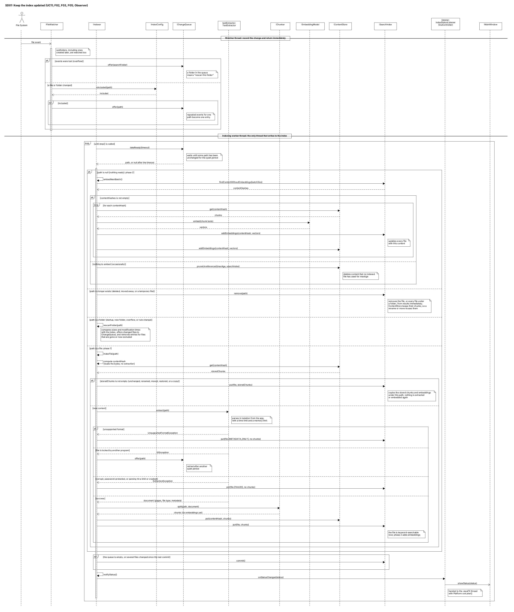

*Figure 10. SD01: Keep the index updated. The watcher thread only records changes in `ChangeQueue`. The indexing worker takes each path once it is ready, removes, rescans, or indexes it, and notifies the GUI through `IndexStatusListener`. When nothing is ready, it embeds stored content (phase 2).*

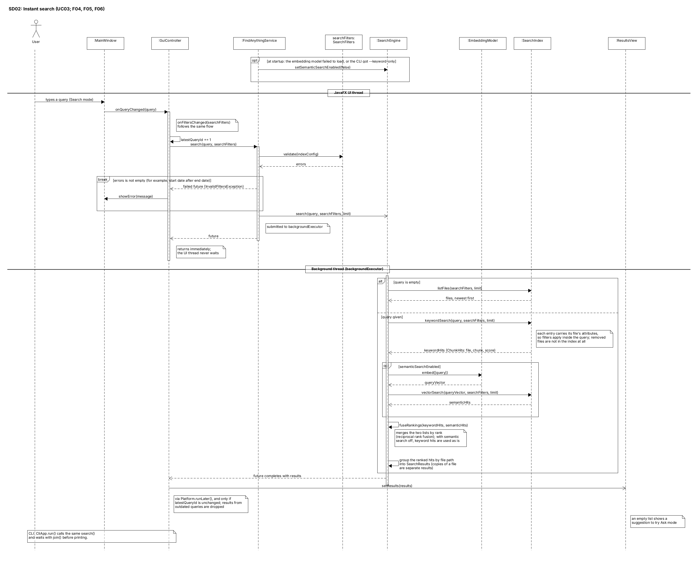

*Figure 11. SD02: Instant search. Filters are validated on the UI thread. The search itself runs on a background thread, where keyword and semantic hits are retrieved and fused. Results from outdated queries are dropped. No language model is involved.*

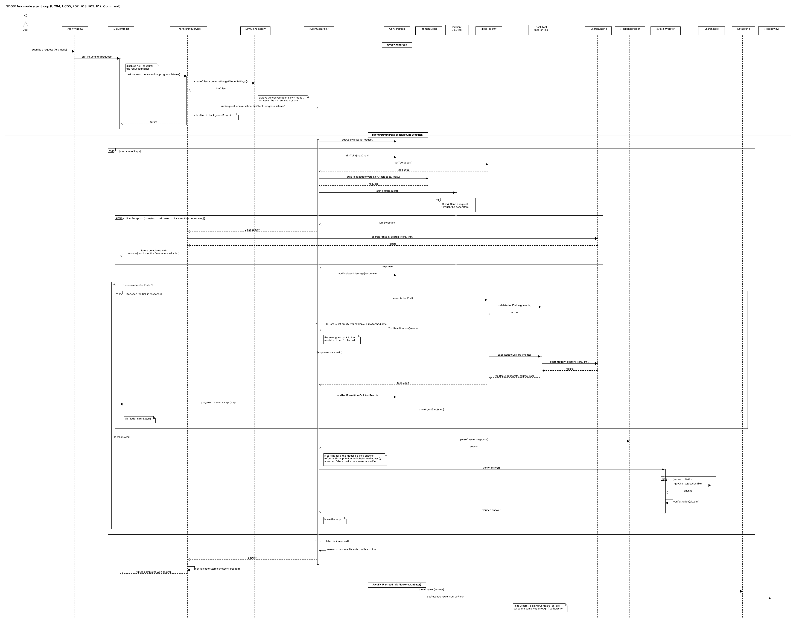

*Figure 12. SD03: Ask mode agent loop. The conversation's own model chooses tools, `ToolRegistry` validates and executes them, and the final answer's citations are verified against the index. If the model is unavailable, the request falls back to instant search.*

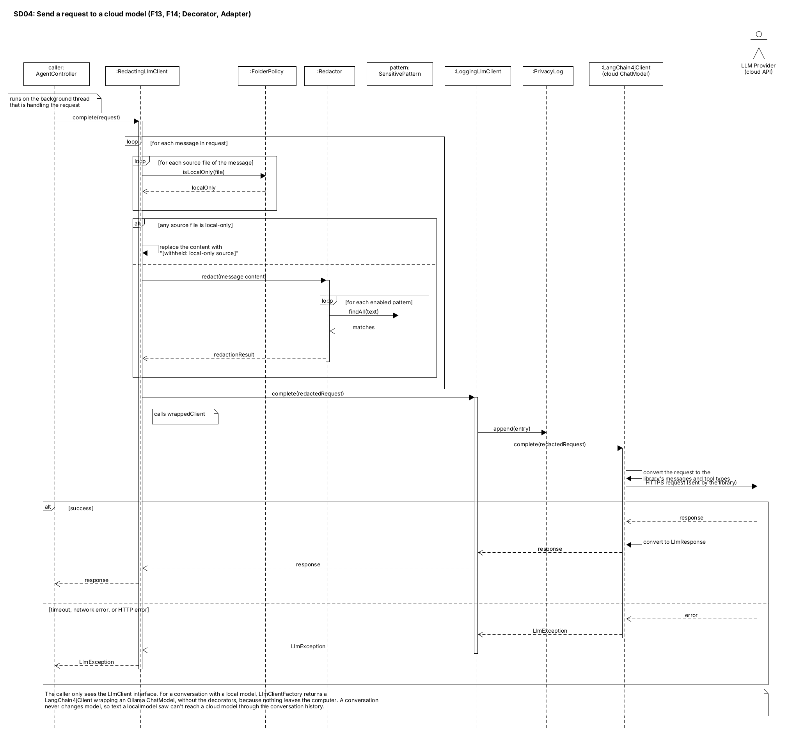

*Figure 13. SD04: Send a request to a cloud model. The request passes through the redaction and logging decorators before the adapter converts it to the library's types.*

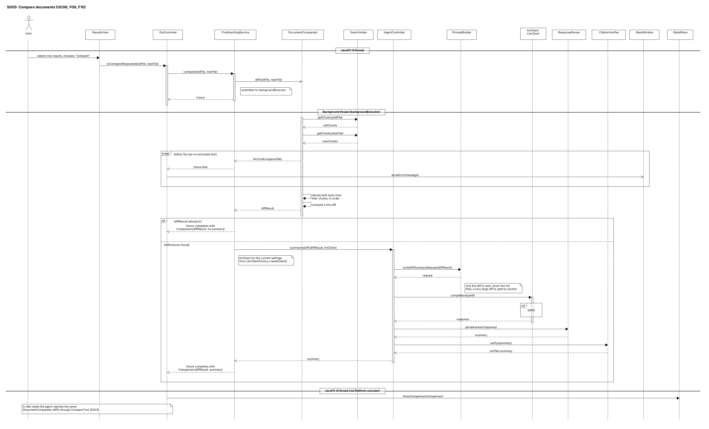

*Figure 14. SD05: Compare documents. A deterministic diff is computed from the indexed text, and only the diff is sent to the model for a summary.*

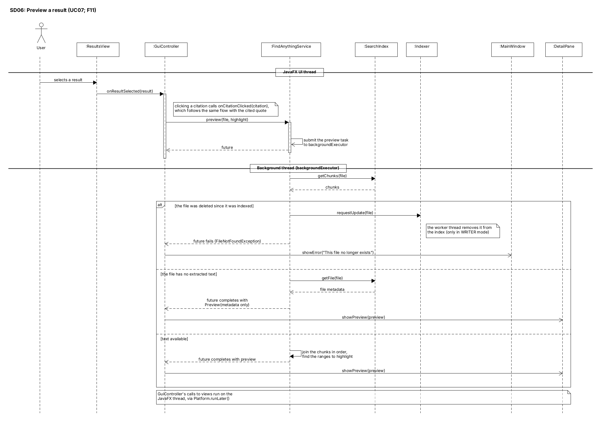

*Figure 15. SD06: Preview a result. The file's text is rebuilt from its chunks, with the matches or the cited passage highlighted.*

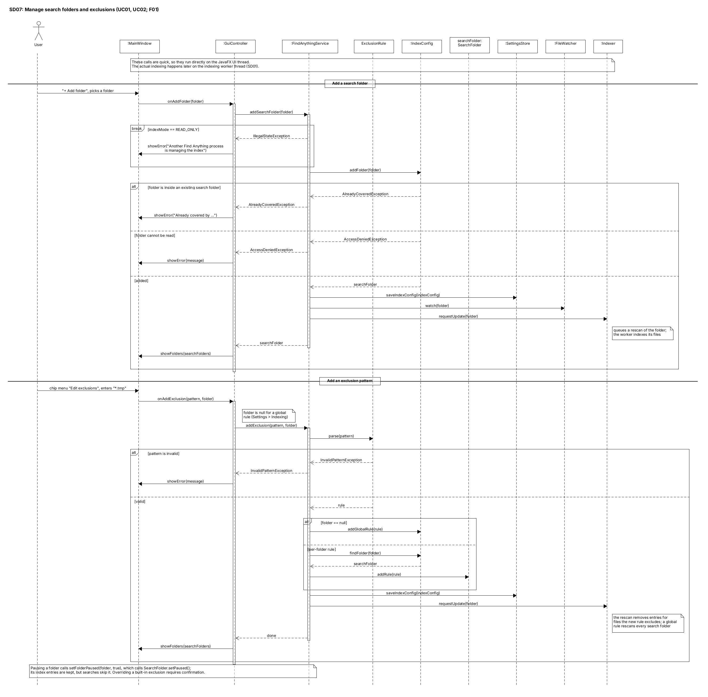

*Figure 16. SD07: Manage search folders and exclusions. These calls are quick and run on the UI thread; the indexing they cause happens later on the worker thread (SD01).*

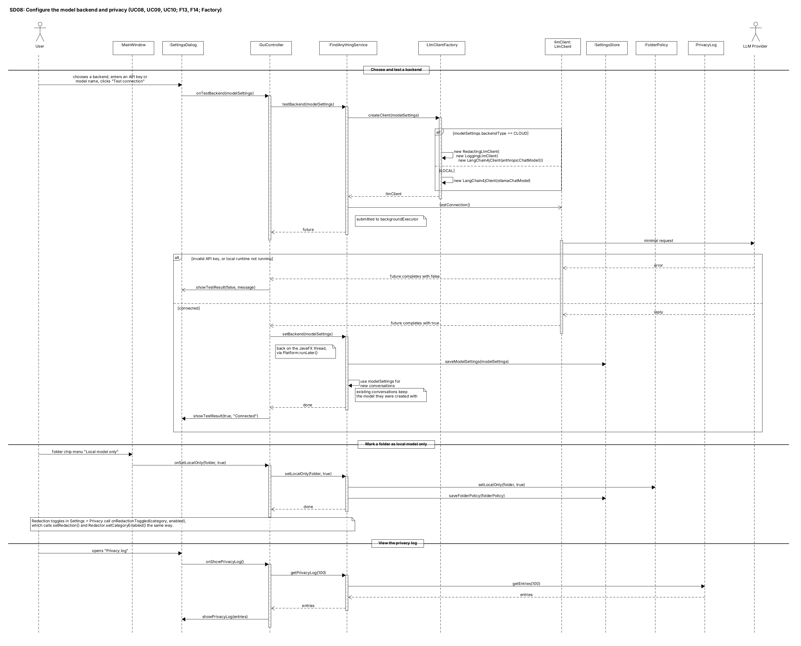

*Figure 17. SD08: Configure the model backend and privacy settings, and view the privacy log. `LlmClientFactory` builds the decorated chain for a cloud backend and a plain client for a local one.*

## 8. Feature-to-design traceability

Each feature maps to the use case that describes it, the main classes and methods that implement it, the sequence diagram that shows its runtime behaviour, and the design patterns involved. A method is written as `Class.method()` when its class isn't obvious from the row.

| Feature | Use case | Classes | Methods | Sequence diagram | Design pattern(s) |
|----------|-------|-----------------------|----------------------------------|-------|---------|
| F01 Search folder management | UC01, UC02 | MainWindow, GuiController, FindAnythingService, IndexConfig, SearchFolder, ExclusionRule, SettingsStore, FileWatcher, Indexer | GuiController.onAddFolder(), onAddExclusion(); FindAnythingService.addSearchFolder(), addExclusion(), setFolderPaused(); IndexConfig.addFolder(); ExclusionRule.parse(); SearchFolder.addRule(); SettingsStore.saveIndexConfig(); FileWatcher.watch(); Indexer.requestUpdate() | SD07 | Facade, MVC |
| F02 Text extraction across formats | UC11 | Indexer, TextExtractor, IsolatedTextExtractor, Chunker, ContentStore, SearchIndex, IndexedFile, Chunk | Indexer.indexFile(); TextExtractor.extract(); Chunker.split(); ContentStore.get(), put(); SearchIndex.put() | SD01 | Adapter |
| F03 Incremental index updates | UC11 | FileWatcher, ChangeQueue, IndexConfig, Indexer, SearchIndex, ContentStore, IndexStatusListener, GuiController | ChangeQueue.offer(), takeReady(); IndexConfig.isIncluded(); Indexer.rescanFolder(), indexFile(), notifyStatus(); SearchIndex.remove(), commit(); GuiController.onStatusChanged() | SD01 | Observer |
| F04 Filters | UC03 (Apply filters) | GuiController, FindAnythingService, SearchFilters, IndexConfig, SearchIndex | GuiController.onFiltersChanged(); FindAnythingService.search(); SearchFilters.validate(); SearchIndex.keywordSearch(), vectorSearch() | SD02 | Facade |
| F05 Semantic search | UC03, UC11 | SearchEngine, EmbeddingModel, LocalEmbeddingModel, SearchIndex, Indexer, ContentStore | EmbeddingModel.embed(); SearchIndex.vectorSearch(), findContentWithoutEmbeddings(), addEmbeddings(); Indexer.embedNextBatch(); SearchEngine.setSemanticSearchEnabled() | SD01, SD02 | Adapter |
| F06 Instant hybrid search | UC03 | MainWindow, GuiController, FindAnythingService, SearchEngine, SearchIndex, SearchResult, ResultsView | GuiController.onQueryChanged(); FindAnythingService.search(); SearchEngine.search(), fuseRankings(); SearchIndex.keywordSearch(), listFiles(); ResultsView.setResults() | SD02 | Facade, MVC |
| F07 Natural-language search | UC04 | GuiController, FindAnythingService, LlmClientFactory, AgentController, PromptBuilder, LlmClient, ToolRegistry, Tool, SearchTool, SearchEngine, DetailPane | GuiController.onAskSubmitted(); FindAnythingService.ask(); LlmClientFactory.createClient(); AgentController.run(); PromptBuilder.buildRequest(); LlmClient.complete(); ToolRegistry.getToolSpecs(), execute(); Tool.validate(), execute(); DetailPane.showAgentStep() | SD03 (SD04 by reference) | Command, Adapter, Facade |
| F08 Question answering across files | UC05 | AgentController, ToolRegistry, ReadExcerptTool, SearchIndex, ResponseParser, Answer, Citation, DetailPane, ResultsView | AgentController.run(); ToolRegistry.execute(); ResponseParser.parseAnswer(); DetailPane.showAnswer(); ResultsView.setResults() | SD03 (SD04 by reference) | Command, Adapter |
| F09 Citation verification | UC05, UC06 (Verify citations) | CitationVerifier, Answer, Citation, SearchIndex, PromptBuilder | CitationVerifier.verify(), verifyCitation(); SearchIndex.getChunks(); PromptBuilder.buildReformatRequest(); Answer.isVerified() | SD03, SD05 | — |
| F10 Document comparison | UC06 | ResultsView, GuiController, FindAnythingService, DocumentComparator, DiffResult, AgentController, PromptBuilder, CompareTool, DetailPane | GuiController.onCompareRequested(); FindAnythingService.compare(); DocumentComparator.diff(); DiffResult.isEmpty(); AgentController.summarizeDiff(); PromptBuilder.buildDiffSummaryRequest(); DetailPane.showComparison() | SD05 | Facade, Command |
| F11 Result preview with highlighting | UC07 | ResultsView, GuiController, FindAnythingService, SearchIndex, Indexer, DetailPane | GuiController.onResultSelected(), onCitationClicked(); FindAnythingService.preview(); SearchIndex.getChunks(), getFile(); Indexer.requestUpdate(); DetailPane.showPreview() | SD06 | Facade, MVC |
| F12 Conversation follow-ups | UC04, UC05 | Conversation, ConversationStore, AgentController, PromptBuilder, FindAnythingService, GuiController | Conversation.addUserMessage(), addAssistantMessage(), addToolResult(), trimToFit(), getModelSettings(); ConversationStore.save(), load(); FindAnythingService.newConversation(), openConversation() | SD03 | — |
| F13 Model backend selection and privacy log | UC08, UC09 | SettingsDialog, GuiController, FindAnythingService, LlmClientFactory, LlmClient, LangChain4jClient, LoggingLlmClient, PrivacyLog, SettingsStore, ModelSettings | GuiController.onTestBackend(), onShowPrivacyLog(); FindAnythingService.testBackend(), setBackend(), getPrivacyLog(); LlmClientFactory.createClient(); LlmClient.testConnection(); SettingsStore.saveModelSettings(); PrivacyLog.append(), getEntries() | SD04, SD08 | Factory, Adapter, Decorator |
| F14 Sensitive-data protection | UC02, UC05, UC09, UC10; Redact outgoing text (included by UC04–UC06) | RedactingLlmClient, Redactor, SensitivePattern, FolderPolicy, IndexConfig, LlmClientFactory, GuiController, FindAnythingService | GuiController.onSetLocalOnly(), onRedactionToggled(); FindAnythingService.setLocalOnly(), setRedaction(); FolderPolicy.setLocalOnly(), isLocalOnly(); Redactor.redact(), setCategoryEnabled(); SensitivePattern.findAll(); RedactingLlmClient.complete() | SD04, SD08 | Decorator, Factory |

## 9. Feature implementation explanations

**F01: Search folder management.** `MainWindow` passes the user's choice to `GuiController.onAddFolder()`, which calls `FindAnythingService.addSearchFolder()`. The facade first refuses the change if the index is `READ_ONLY`. It then calls `IndexConfig.addFolder()`, which rejects a folder that can't be read or is already covered. Next it saves the configuration with `SettingsStore.saveIndexConfig()`, starts `FileWatcher.watch()`, and calls `Indexer.requestUpdate(folder)`, which queues a rescan of the whole folder. Exclusions work the same way through `addExclusion()`: `ExclusionRule.parse()` validates the pattern, and the rule is added to a `SearchFolder` or to `IndexConfig`'s global rules. `IndexConfig.isIncluded()` combines the built-in, global, and per-folder rules, and both the watcher and the rescan consult it. These calls are quick, so they run on the UI thread; the indexing work they cause happens later on the worker thread, as shown in SD01 (SD07).

**F02: Text extraction across formats.** On the indexing worker thread, `Indexer.indexFile()` hashes the file's bytes and asks `ContentStore.get()` whether that content was already processed. If it wasn't, the indexer calls `TextExtractor.extract()`. Its adapter, `IsolatedTextExtractor`, runs the parser in a separate process with a time limit and a memory limit, and returns an `ExtractedDocument` with pages, file type, and metadata. Each failure has its own exception:

- `UnsupportedFormatException` produces an `IndexedFile` marked `METADATA_ONLY`.
- An `IOException` (the file is locked) puts the path back in the queue.
- `ExtractionException` produces an `IndexedFile` marked `FAILED`.

`Chunker.split()` splits each page separately, so every `Chunk` keeps its page number. The chunks are stored in `ContentStore` under the content hash and in `SearchIndex` under the file's path. The file is then keyword-searchable (SD01).

**F03: Incremental index updates.** `FileWatcher` runs on its own thread. For each event, it checks `IndexConfig.isIncluded()` and calls `ChangeQueue.offer(path)`, which only records the latest change time, so a burst of events becomes one entry. When the operating system reports lost events, it offers the whole search folder instead. The indexing worker loops on `ChangeQueue.takeReady()`, which returns a path once it has been unchanged for the quiet period. The worker then handles the path:

- A path that no longer exists is removed with `SearchIndex.remove()`.
- A folder is rescanned with `rescanFolder()`, which compares sizes and modification times with the index.
- A file is indexed with `indexFile()`. A renamed or moved file reuses its stored chunks, because its content hash is already in `ContentStore`.

The worker commits when the queue empties or enough files have changed. It then calls `notifyStatus()`, which calls `onStatusChanged()` on each `IndexStatusListener`; `GuiController` forwards the update to `MainWindow.showStatus()` on the JavaFX thread (Observer). At startup, `FindAnythingService.open()` tries to take the index's write lock through `SearchIndex.open()`. If another process holds it, the index opens `READ_ONLY`, no watcher or worker is started, and `SearchIndex.refresh()` is called every few seconds (SM01).

**F04: Filters.** `GuiController.onFiltersChanged()` stores the new `SearchFilters` and re-runs the current search. `FindAnythingService.search()` calls `SearchFilters.validate(indexConfig)` before anything else; any errors fail the future, and `MainWindow.showError()` shows them inline. Valid filters are passed to `SearchIndex.keywordSearch()`, `vectorSearch()`, and `listFiles()`. Each index entry carries its file's type, size, modification time, and path, so the filters are applied inside the query rather than afterwards (SD02). The agent's `SearchTool` passes the same `SearchFilters` to `SearchEngine.search()`.

**F05: Semantic search.** Embedding happens in a second indexing phase. When `takeReady()` returns nothing, `Indexer.embedNextBatch()` asks `SearchIndex.findContentWithoutEmbeddings()` for content hashes without vectors. It loads their chunks from `ContentStore`, calls `EmbeddingModel.embed()`, and stores the vectors with `addEmbeddings()` in both stores, which updates every file with that content. At search time, `SearchEngine.search()` embeds the query with the same model and calls `SearchIndex.vectorSearch()`. `LocalEmbeddingModel` adapts an in-process ONNX model to `EmbeddingModel`. If it fails to load, or the CLI gets `--keyword-only`, the facade calls `SearchEngine.setSemanticSearchEnabled(false)` (SD01, SD02).

**F06: Instant hybrid search.** Each keystroke calls `GuiController.onQueryChanged()`, which increments `latestQueryId` and calls `FindAnythingService.search()`. The facade submits `SearchEngine.search()` to its background executor and returns a future at once, so the UI never waits. The engine works as follows:

- An empty query calls `SearchIndex.listFiles()`, which returns files newest first.
- Otherwise, it calls `keywordSearch()` and, if semantic search is enabled, `vectorSearch()`. `fuseRankings()` merges the two lists by rank (reciprocal rank fusion), and the ranked `ChunkHit`s are grouped by path into `SearchResult`s.

When the future completes, `GuiController` calls `ResultsView.setResults()` through `Platform.runLater()`, but only if `latestQueryId` hasn't changed (SD02).

**F07: Natural-language search.** `GuiController.onAskSubmitted()` disables Ask input and calls `FindAnythingService.ask()`. The facade gets the client for the conversation's own model from `LlmClientFactory.createClient(conversation.getModelSettings())` and submits `AgentController.run()` to the background executor. Each step of the loop works as follows:

1. `Conversation.trimToFit()` keeps the history within the model's context.
2. `PromptBuilder.buildRequest()` combines the conversation, `ToolRegistry.getToolSpecs()`, and today's date into an `LlmRequest`.
3. `LlmClient.complete()` sends it.
4. For each `ToolCall` in the response, `ToolRegistry.execute()` calls `Tool.validate()` and then `Tool.execute()` on the matching command. `SearchTool` calls `SearchEngine.search()`.
5. Each `ToolResult` is added with `Conversation.addToolResult()`, and the step is reported through the progress listener to `DetailPane.showAgentStep()`.

The loop ends when the model gives a final answer or `maxSteps` is reached. If the client throws an `LlmException`, the facade completes the future with instant search results and a "model unavailable" notice (SD03).

**F08: Question answering across files.** The loop is the same as F07. The model typically calls `SearchTool` to find candidate files and `ReadExcerptTool` to read their chunks from `SearchIndex`; `ReadExcerptTool` is limited to `maxExcerptChars`, so only excerpts are sent. Each `ToolResult` lists its `sourceFiles`, which the redacting decorator uses (F14). When the model returns its final answer, `ResponseParser.parseAnswer()` turns it into an `Answer` with `Citation`s. `CitationVerifier.verify()` checks each citation (F09). The facade saves the conversation with `ConversationStore.save()` and completes the future. `GuiController` then calls `DetailPane.showAnswer()` and `ResultsView.setResults(answer.sourceFiles)` (SD03).

**F09: Citation verification.** `CitationVerifier.verify(answer)` loads the cited file's chunks with `SearchIndex.getChunks(citation.file)`. For each citation, `verifyCitation()` searches the chunks on the cited page for the quote, ignoring differences in whitespace, and returns `VERIFIED`, `UNVERIFIED`, or `SOURCE_CHANGED` (the file on disk has changed since it was indexed). If `ResponseParser` can't parse the answer, `AgentController` sends one `PromptBuilder.buildReformatRequest()`. A second failure produces an answer whose `isVerified()` is false. Comparison summaries go through the same verifier (SD03, SD05).

**F10: Document comparison.** `GuiController.onCompareRequested()` calls `FindAnythingService.compare()`, which runs `DocumentComparator.diff()` on a background thread. The comparator rebuilds both texts from `SearchIndex.getChunks()` in order and computes a line diff as a `DiffResult` of `DiffHunk`s. If `DiffResult.isEmpty()`, the comparison is returned without calling a model. Otherwise, the facade calls `AgentController.summarizeDiff()` with a client from `LlmClientFactory`. That method sends `PromptBuilder.buildDiffSummaryRequest()`, which contains only the diff. The summary is parsed and verified like an answer. `DetailPane.showComparison()` shows both. In Ask mode, `CompareTool` reaches the same `diff()` through `ToolRegistry` (SD05).

**F11: Result preview with highlighting.** `GuiController.onResultSelected()` (or `onCitationClicked()`, with the cited quote) calls `FindAnythingService.preview(file, highlight)`. On a background thread, the facade loads the chunks with `SearchIndex.getChunks()`, joins them in order, and finds the ranges to highlight. It returns a `Preview`, which `DetailPane.showPreview()` displays scrolled to the first highlight. The two exceptional cases are handled as follows:

- If the file no longer exists, the facade calls `Indexer.requestUpdate(file)` so the worker removes it, and the future fails with a message.
- If the file has no text, `SearchIndex.getFile()` supplies the metadata for a metadata-only preview (SD06).

**F12: Conversation follow-ups.** A `Conversation` holds its `Message`s, its `lastResults`, and the `ModelSettings` it was created with. `AgentController.run()` calls `addUserMessage()`, `addAssistantMessage()`, and `addToolResult()` as the loop proceeds. `PromptBuilder.buildRequest()` sends the whole trimmed history, so the model can resolve references like "the second one." `ConversationStore.save()` persists the conversation after each answer. `FindAnythingService.newConversation()`, `listConversations()`, and `openConversation()` back the conversation drawer. Because the factory is always asked for a client for `conversation.getModelSettings()`, a conversation never switches model. A conversation is used by one request at a time, since the GUI disables Ask input while a request runs (SD03).

**F13: Model backend selection and privacy log.** In `SettingsDialog`, "Test connection" calls `GuiController.onTestBackend()`, then `FindAnythingService.testBackend()`. The facade gets a client from `LlmClientFactory.createClient(modelSettings)` and calls `LlmClient.testConnection()` on a background thread. On success, `GuiController` calls `setBackend()`, which saves the settings with `SettingsStore.saveModelSettings()` and uses them for new conversations. `LangChain4jClient` adapts the library's chat models for both Anthropic (cloud) and Ollama (local), so the rest of the system only knows `LlmClient`. For a cloud backend, `LoggingLlmClient` appends a `PrivacyLogEntry` with `PrivacyLog.append()` before each request is sent. `onShowPrivacyLog()` calls `getPrivacyLog(100)`, which reads the log with `PrivacyLog.getEntries()` (SD04, SD08).

**F14: Sensitive-data protection.** The three protections are implemented in different places:

- **Built-in exclusions:** `IndexConfig`'s built-in rules keep credential locations out of the index entirely.
- **Local-only folders:** "Local model only" calls `GuiController.onSetLocalOnly()`, then `FindAnythingService.setLocalOnly()`, which updates `FolderPolicy` and saves it.
- **Redaction:** The redaction toggles call `setRedaction()`, which calls `Redactor.setCategoryEnabled()`.

For a cloud backend, `LlmClientFactory` wraps the client in `RedactingLlmClient`. Its `complete()` checks each message's source files with `FolderPolicy.isLocalOnly()`. It replaces the content of any message from a local-only folder with a withheld marker, and passes the rest through `Redactor.redact()`, which applies every enabled `SensitivePattern`'s `findAll()`. The redacted request then goes to `LoggingLlmClient` and the adapter (Decorator). A local backend gets no decorators, because nothing leaves the computer (SD04, SD08).

## 10. Concurrency and the index lifecycle

Indexing and model requests are slow, and the GUI must stay responsive while they run. The design follows a few rules, which the notes on the class diagrams state where they apply:

- **The UI thread never waits.** Every slow facade method returns a `CompletableFuture`. `GuiController` applies results with `Platform.runLater()` and drops outdated search results.
- **The index has one writer.** Only the indexing worker thread writes to `SearchIndex` and `ContentStore`. Every other thread only reads the last committed snapshot, and `requestUpdate()` just offers a path to `ChangeQueue`.
- **Shared objects are thread-safe.** `IndexConfig`, `ChangeQueue`, `EmbeddingModel`, `SearchEngine`, `Redactor`, `FolderPolicy`, and `PrivacyLog` are used by several threads, and their notes say so.
- **One process owns the index.** The first process to open the index takes its write lock; any other process (for example, the CLI while the GUI is open) opens it read-only, runs no watcher or worker, and refreshes every few seconds.

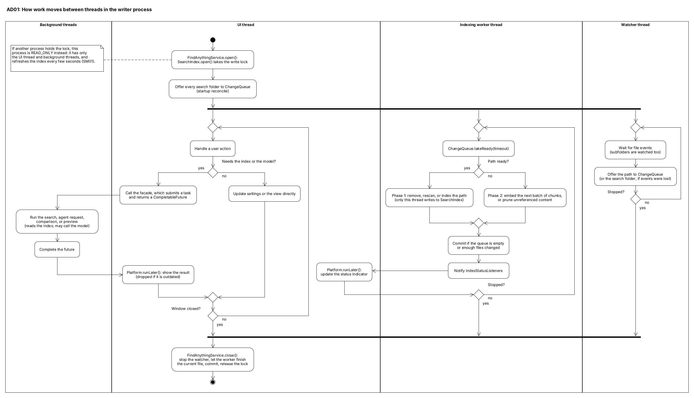

*Figure 18. AD01: How work moves between threads in the writer process.*

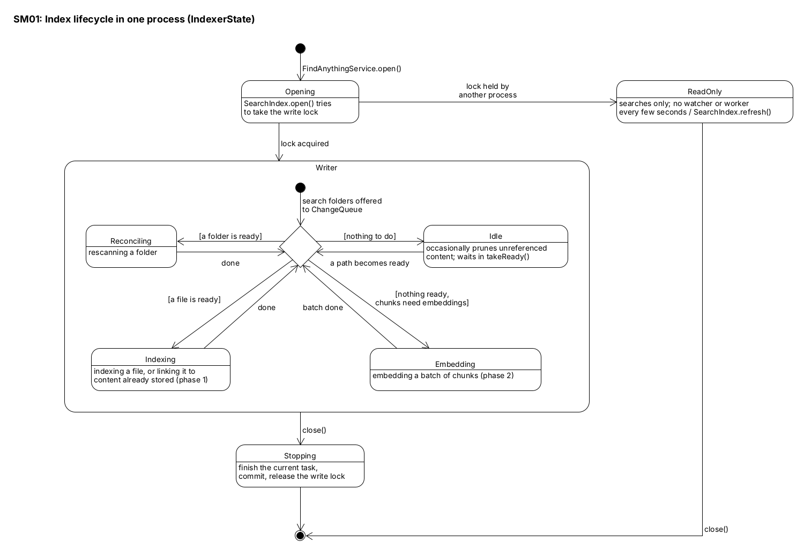

*Figure 19. SM01: The index lifecycle in one process (`IndexerState`). The `state` attribute of `Indexer` and `IndexStatus` takes the values of these states.*
